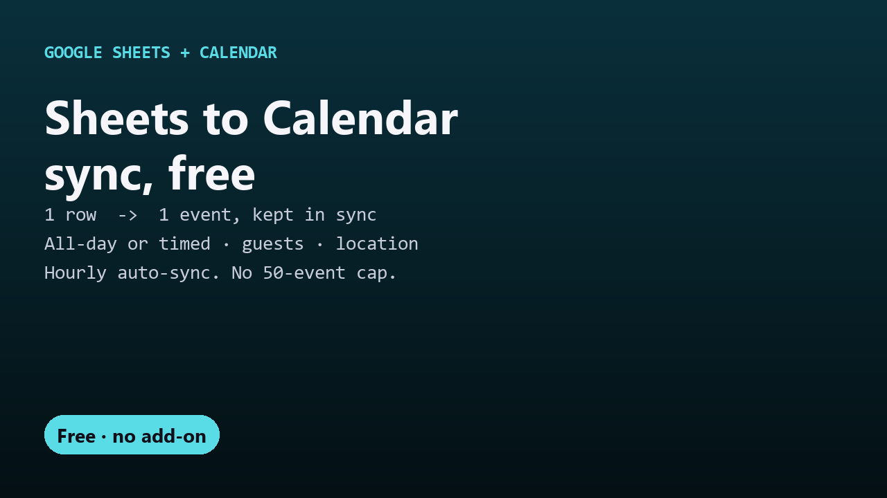

# Free Sheets to Calendar sync

Create Google Calendar events from Google Sheets rows and keep them in sync when you edit the sheet. One free Apps Script file, no add-on.

## Guides

- [How to add Google Sheets rows to Google Calendar automatically](google-sheets-to-google-calendar.html)

## Get it

The script and full instructions are on GitHub: [DecodedXR/sheets-to-calendar](https://github.com/DecodedXR/sheets-to-calendar). It's MIT licensed and free.
